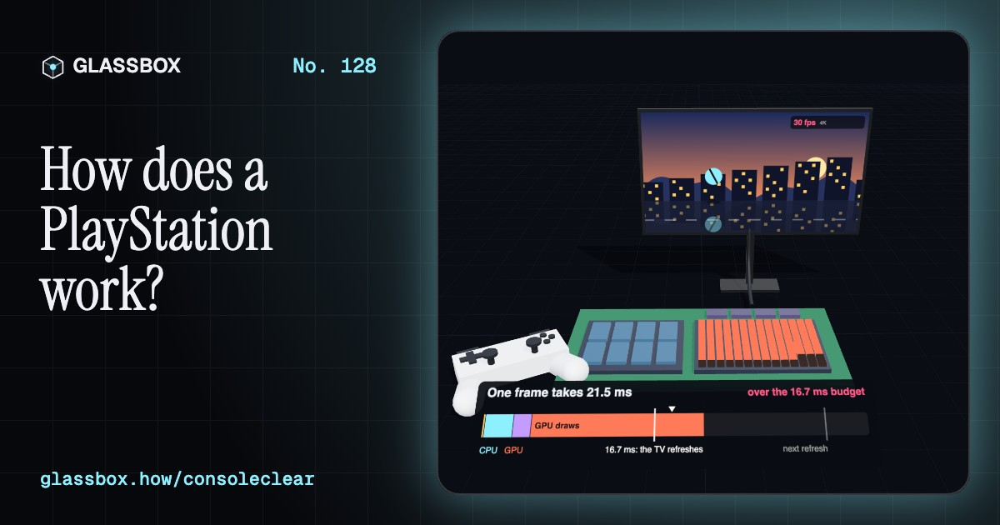
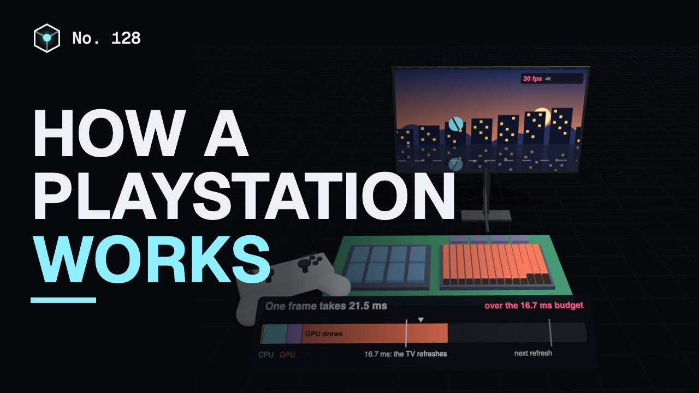
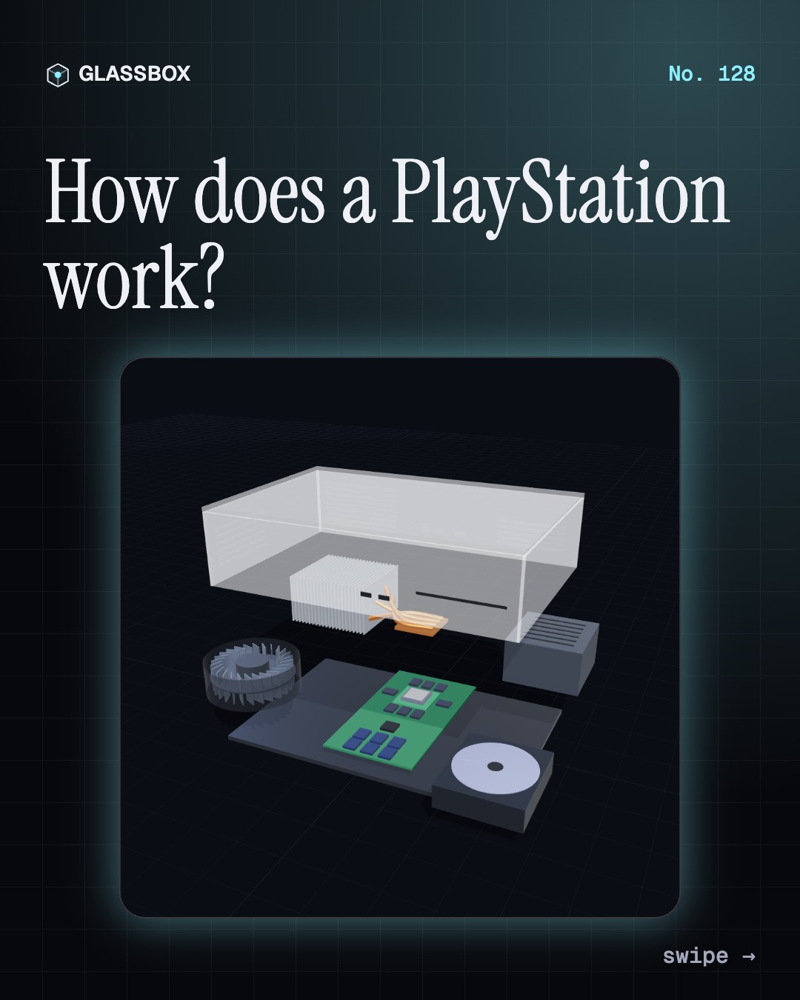
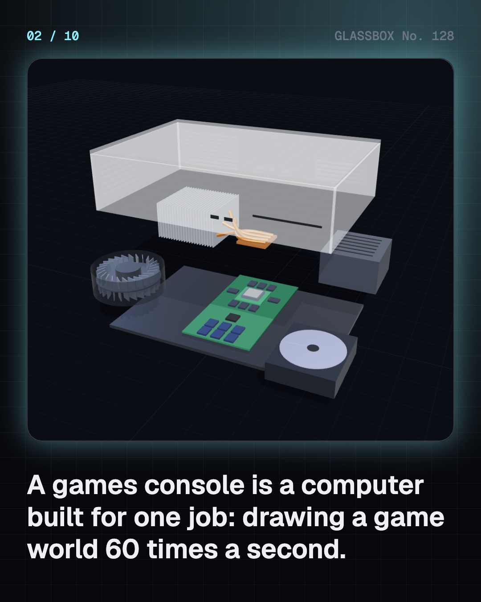
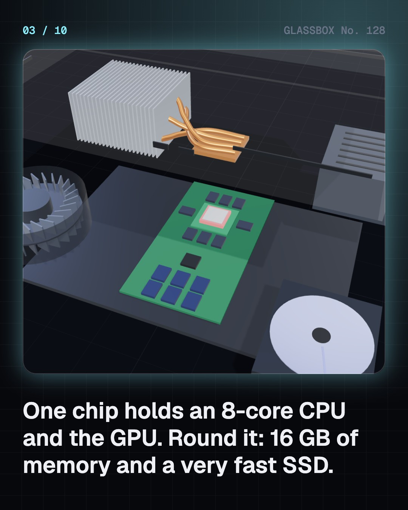
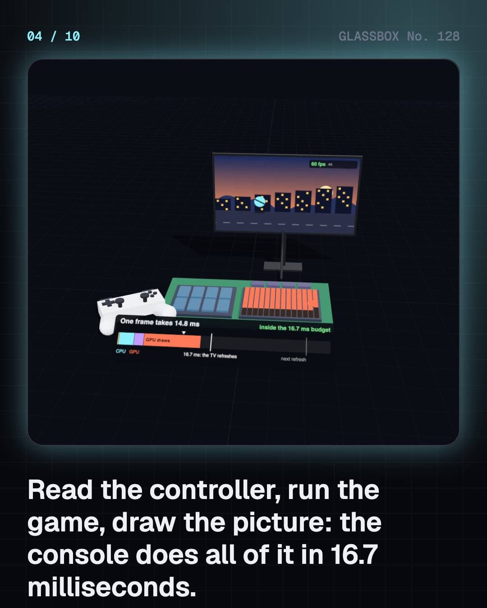

<!-- glassbox:start -->
<!-- Generated from glassbox.json by the Glassbox hub (npm run readme -- consoleclear). Edit glassbox.json, not this block. -->
<p align="center"><a href="https://glassbox.how/e/consoleclear/"></a></p>

<h1 align="center">ConsoleClear</h1>

<p align="center"><b>How does a PlayStation work?</b><br>Sixty times a second, a console reads your thumbs, runs a whole world and paints 8 million pixels, all in 16.7 milliseconds. Open one up in 3D and see how a PlayStation does it, and why it needs so much cooling.</p>

<p align="center"><a href="https://glassbox.how/consoleclear/"><b>▶ Play with it</b></a> &nbsp;·&nbsp; <a href="https://glassbox.how/e/consoleclear/">Read the 60-second explainer</a> &nbsp;·&nbsp; <a href="https://glassbox.how/consoleclear/glassbox/reel.mp4">Watch the 40-second video</a></p>

<p align="center">
  <a href="https://glassbox.how/e/consoleclear/"></a>
  <a href="https://glassbox.how/e/consoleclear/"></a>
  <a href="LICENSE"></a>
  <a href="LICENSE-CONTENT.md"></a>
  <a href="#privacy"></a>
</p>

## In 60 seconds

1. **A computer built for one job.** A games console is a computer with every part chosen in advance. In a PlayStation 5, one chip holds an 8-core CPU and the GPU. Round it sit 16 GB of memory, an 825 GB SSD, a disc drive, a 350 W power supply and a large heatsink with a 120 mm fan.
2. **One frame every 16.7 milliseconds.** Nothing in a game is drawn in advance. For every frame the console reads the controller, runs the game's rules on the CPU, sends draw calls to the GPU and stores the finished picture for the TV. At 60 frames a second that must all fit in 16.7 ms. Miss the deadline and 60 fps drops to 30.
3. **Triangles into pixels.** Game worlds are skins of triangles. The GPU places every corner on the screen, finds which pixels each triangle covers, then works out a colour for each pixel. Ray tracing adds rays fired towards lights and off shiny surfaces for true shadows and reflections. A 4K picture has 8.3 million pixels, so the work is huge.
4. **Why loading got fast.** A hard disk must swing an arm to the right track and wait for the platter to turn, thousands of times per level. An SSD has no moving parts and reads any flash cell directly. The PS5's SSD reads 5.5 GB a second, and a chip unpacks compressed game data on the way in.
5. **A controller is sensors and motors.** Each thumb stick turns two potentiometers, and when their carbon tracks wear the stick drifts. Triggers can push back with a motor and worm gear. Voice coils, the motors of loudspeakers, make detailed vibration. A Bluetooth link carries it all, and every step adds a little lag.
6. **200 watts of heat.** Almost all the electricity a console uses becomes heat. Liquid metal passes it from the chip to copper, heat pipes carry it to a stack of fins, and a fan blows air through them. A hotter chip makes the fan spin faster, and noise climbs steeply with fan speed.

## Words worth knowing

| Term | Meaning |
|---|---|
| **System-on-chip** | One chip that holds the CPU, the GPU and more. A console's main processor is one. |
| **Frame** | One complete picture of the game. Consoles draw 30, 60 or 120 of them every second. |
| **Frame budget** | The time allowed for one frame: 16.7 ms at 60 frames a second, 8.3 ms at 120. |
| **Rasterising** | Working out which pixels each triangle covers on the screen. |
| **Ray tracing** | Following rays of light through a scene to get true shadows and reflections. |
| **Upscaling** | Drawing a picture with fewer pixels, then enlarging it to fill the screen. |
| **SSD** | Storage made of flash memory chips. With no moving parts, it can read any data at once. |
| **Stick drift** | A worn thumb stick reporting movement when no one is touching it. |
| **Heat pipe** | A sealed copper tube that moves heat by boiling a liquid at one end and condensing it at the other. |

## A short history

**From a dot on an oscilloscope in 1958 to machines that trace rays of light sixty times a second.**

- **1967** · The Brown Box plays games on a TV (Ralph Baer, Bill Harrison and Bill Rusch, Sanders Associates, Nashua, New Hampshire)
- **1972** · The first home console goes on sale (Magnavox, from Ralph Baer's design, United States)
- **1976** · Games on swappable cartridges (Jerry Lawson's team at Fairchild; Wallace Kirschner and Lawrence Haskel at Alpex, Silicon Valley, California)
- **1977** · The Atari 2600 (Atari (Jay Miner, Joe Decuir and others), Sunnyvale, California)
- **1983** · The Famicom (Masayuki Uemura's team at Nintendo, Kyoto, Japan)
- **1991** · Nintendo walks away from Sony (Hiroshi Yamauchi (Nintendo); Ken Kutaragi (Sony), Consumer Electronics Show, Chicago)
- **1994** · The PlayStation (Ken Kutaragi's team at Sony Computer Entertainment, Japan)
- **2000** · The PlayStation 2 (Sony Computer Entertainment, Japan)

The full story, with 29 moments, charts, people and 40 sources: [glassbox.how/e/consoleclear/history](https://glassbox.how/e/consoleclear/history/). The data lives in [`history.json`](history.json).

## Video and slides

Made with the Glassbox studio from this box's storyboard (`window.glassbox.director`). Free to reuse under CC BY 4.0.

<a href="https://glassbox.how/consoleclear/glassbox/video.mp4"></a>

<p><a href="glassbox/slide-1.jpg"></a> <a href="glassbox/slide-2.jpg"></a> <a href="glassbox/slide-3.jpg"></a> <a href="glassbox/slide-4.jpg"></a></p>

| File | What | Size |
|---|---|---|
| [`glassbox/reel.mp4`](https://glassbox.how/consoleclear/glassbox/reel.mp4) | Reel / Short, with captions and soundtrack | 1080×1920 |
| [`glassbox/video.mp4`](https://glassbox.how/consoleclear/glassbox/video.mp4) | YouTube video, with captions and soundtrack | 1920×1080 |
| `glassbox/slide-1…10.jpg` | Instagram carousel | 1080×1350 |
| `glassbox/thumb.jpg` | YouTube thumbnail | 1280×720 |
| `glassbox/cover.jpg` | Share card and repo social preview | 1200×630 |
| [`glassbox/history-reel.mp4`](https://glassbox.how/consoleclear/glassbox/history-reel.mp4) | “History in 10 moments” Reel / Short | 1080×1920 |
| `glassbox/history-slide-*.jpg` | History carousel | 1080×1350 |
| `glassbox/post.json` | Post copy and schedule used by the publish kit | |

## Privacy

This box has no accounts and no ads, and it ships its own fonts and libraries. When you run it yourself it sends nothing anywhere. On glassbox.how, the site's `/bar.js` also loads Glassbox's analytics: **Google Analytics** to count visits (it asks first in the EU, UK and Switzerland, and stays off when your browser sends Global Privacy Control or Do Not Track) and **ClickTrust** to detect bots.

It remembers a few things **in your own browser only**, and never sends them anywhere:

| Browser storage key | What it holds |
|---|---|
| `consoleclear.v1` | Which chapters you have opened, your best quiz scores, and sound on or off. |

Exactly what each one sees is at [glassbox.how/privacy](https://glassbox.how/privacy/).

## Licences

- **Code:** [MIT](LICENSE). Use it, change it, ship it.
- **Explanations, text, images and videos** (`glassbox.json`, `glassbox/`): [CC BY 4.0](LICENSE-CONTENT.md). Credit “Glassbox, glassbox.how/e/consoleclear”.
- **Third-party parts** keep their own licences: [three.js](https://threejs.org) (MIT), [Geist, Instrument Serif](https://openfontlicense.org) (SIL OFL 1.1).
- The Glassbox name and logo aren't covered by either licence. See the [terms](https://glassbox.how/terms/).

Found a mistake? [Open an issue](https://github.com/bdeeps/consoleclear/issues). Corrections happen in public.
<!-- glassbox:end -->

## Run it

It's plain HTML, CSS and JavaScript. No build step and no dependencies. Run locally, it contacts no other website.

```bash
python3 -m http.server 8000
```

Three.js and the fonts ship in `vendor/` and `fonts/`, so it also works offline.

Then open http://localhost:8000.

## How it's built

| File | What |
|---|---|
| `index.html`, `css/app.css` | The page and its styles |
| `js/app.js`, `js/stage.js`, `js/ui.js`, `js/kit.js` | The shared Glassbox 3D engine: chapters, 3D stage, controls, quiz, video director |
| `js/chapters/*.js` | One file per chapter: the 3D model, controls, text, key terms, quiz and video scenes |
| `js/console.js` | Shared models and helpers for this box: the generic console, blower fan and gamepad, chart boards, and the PS5's published specifications with their sources |
| `glassbox.json` | Title, question, explainer beats, key terms, browser storage and credits shown on glassbox.how |
| `reel` in each chapter | The storyboard the Glassbox studio records into short videos |
| `glassbox/` | The published video, slides, thumbnail and post copy |
| `fonts/`, `vendor/three/` | Self-hosted Geist and Instrument Serif (SIL OFL 1.1) and three.js (MIT) |
